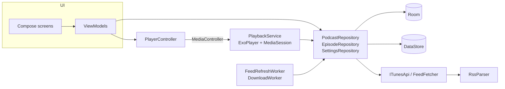

# Podwave

**A podcast player for Android** built with Jetpack Compose and Media3. Find shows in Apple's
public directory, subscribe to their RSS feeds, and listen with background playback, offline
downloads, a queue, variable speed and a sleep timer. No account, no server, no tracking: your
subscriptions and progress live on your phone.

---

## Features

- **Discover**: the current top chart, plus directory search with debounced queries and
  "already subscribed" badges.
- **Subscriptions** checked for new episodes every few hours in the background (WorkManager),
  with conditional `If-None-Match` requests so unchanged feeds cost a few bytes.
- **Streaming RSS parser** that copes with the feeds you find in the wild: iTunes and `content:`
  namespaces, RFC 822 dates with named time zones or wrong weekdays, ISO-8601 dates,
  `HH:MM:SS`/`MM:SS`/seconds durations, missing guids, video-only items and duplicate entries.
- **Playback** through a Media3 `MediaSessionService`: lock screen, notification, Bluetooth and
  headset controls, audio focus, pause on unplug, and resume from where you stopped.
- **Up next** queue: add, play next, swipe to remove; finished episodes drop off automatically.
- **Variable speed** (0.8× to 2×) remembered as your default, and **configurable skip** intervals.
- **Sleep timer**: 5–60 minutes with a gentle fade-out, "+5 min", or stop at the end of the episode.
- **Offline downloads** that survive process death (WorkManager restarts them), respect
  "Wi‑Fi only", show progress in a notification and never leave half-written files behind. Optional auto-download of new
  episodes.
- **Show notes** rendered from HTML with working links, and **tappable timestamps** that jump to
  that point in the episode.
- **Material 3** with dynamic colour, light/dark/system theme, edge-to-edge layout and
  predictive back.

## Tech stack

| Concern | Choice |
| --- | --- |
| UI | Jetpack Compose, Material 3, Navigation Compose (type-safe routes) |
| Playback | Media3 ExoPlayer + `MediaSessionService`, controlled through a `MediaController` |
| Architecture | MVVM with unidirectional data flow, repositories over Room and the network |
| DI | Hilt, including `@HiltWorker` |
| Async | Kotlin Coroutines and Flow |
| Local data | Room (KSP, exported schema, foreign keys) and Preferences DataStore |
| Network | Ktor client (OkHttp engine) + kotlinx.serialization |
| Feed parsing | `XmlPullParser` streaming parser (kXML in JVM tests) |
| Images | Coil 3 sharing the app's Ktor client |
| Background work | WorkManager (periodic refresh, expedited foreground downloads) |
| Tests | JUnit, Truth, Turbine, kotlinx-coroutines-test, Ktor `MockEngine`, Room instrumented tests |

Versions are pinned in [`gradle/libs.versions.toml`](gradle/libs.versions.toml): AGP 8.10,
Kotlin 2.1, Compose BOM 2025.06, Media3 1.6, compile/target SDK 36, min SDK 26.

## Getting started

1. Install Android Studio (Narwhal or newer) with JDK 17+.
2. Clone and open the project:
   ```bash
   git clone https://github.com/<your-username>/podwave.git
   ```
3. Run the `app` configuration on a device or emulator (API 26+).

No API key is needed. Search uses the public iTunes Search API and episodes come straight from
each show's feed.

```bash
./gradlew assembleDebug              # build
./gradlew testDebugUnitTest          # JVM unit tests
./gradlew connectedDebugAndroidTest  # Room tests on a device/emulator
./gradlew lintDebug                  # Android lint
```

## Architecture



- **The database is the source of truth.** Screens observe Room flows; network calls only ever
  write to the database. That is what makes the app work offline and keeps every screen in sync.
- **Playback lives in a service.** The UI never touches ExoPlayer. `PlayerController` talks to
  `PlaybackService` through a `MediaController`, exactly as Android Auto or a smartwatch would,
  and exposes one `StateFlow<PlayerState>` for Compose.
- **Listener state survives refreshes.** Feeds are merged into the database by a pure function,
  `FeedMerger`: publisher metadata always wins, your position, played state and downloads always
  win. Episode ids hash the feed URL with the item guid, so they are stable across refreshes.

More detail in [docs/ARCHITECTURE.md](docs/ARCHITECTURE.md).

## Project layout

```
app/src/main/kotlin/dev/podwave/
├── core/        DI module, qualifiers, small shared helpers
├── data/        repositories, FeedMerger, Room entities and DAOs
├── download/    WorkManager download and refresh workers
├── model/       plain Kotlin models shared by every layer
├── network/     iTunes directory API and the feed fetcher
├── playback/    PlaybackService, PlayerController, sleep timer, media items
├── rss/         streaming RSS parser and date/duration parsing
└── ui/          Compose screens by feature, theme, navigation and shared components
```

## Testing

Business logic is written as plain functions or small classes so it can be tested on the JVM:

- `RssParserTest`, `FeedParsingTest` parse a real-world-shaped feed fixture and the date and
  duration formats publishers actually use.
- `FeedMergerTest` covers how refreshes keep progress and downloads.
- `ITunesApiTest`, `FeedFetcherTest` run the network layer against Ktor's `MockEngine`,
  including ETags and `304 Not Modified`.
- `SleepTimerTest`, `StartPositionTest`, `QueueOrderTest`, `DownloadFilesTest` cover playback
  and download rules.
- `DiscoverViewModelTest` drives debounced search on virtual time with a fake repository.
- `FormattingTest`, `HtmlTest`, `TimestampsTest` cover what the UI shows.
- `PodwaveDatabaseTest` (instrumented) checks queries, ordering and that refreshing episodes
  never empties the queue.

## Roadmap

- Chapters (Podcasting 2.0 `podcast:chapters` and ID3 CHAP)
- OPML import and export
- Android Auto browsing via `MediaLibraryService`
- Per-show playback speed and skip-intro
- Transcripts (`podcast:transcript`)

## Contributing

Issues and pull requests are welcome; see [CONTRIBUTING.md](CONTRIBUTING.md).

## License

[MIT](LICENSE)
