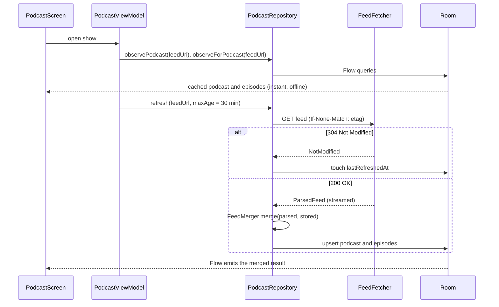
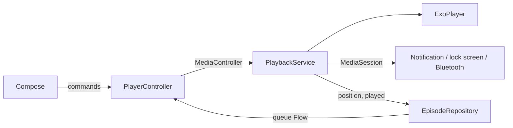

# Architecture

Podwave is a single-module app with packages by layer at the bottom (`rss`, `network`, `data`,
`playback`, `download`) and by feature at the top (`ui/home`, `ui/podcast`, …). It is small
enough that modules would add build time without adding much isolation; the package boundaries
below are kept so that splitting later is mechanical.

## Data flow

The UI never waits on the network to show something. A refresh that fails leaves the cached
copy on screen and shows a snackbar; only a show that has never loaded gets a full-screen error.

## Identity and merging

An RSS `<guid>` is only unique inside one feed, and some feeds omit it. Episodes are identified
by `episodeId(feedUrl, guid)`: the first 12 bytes of SHA-256 over both, hex-encoded. When an item
has no guid, the parser uses its enclosure URL instead.

`FeedMerger` is a pure function from *(parsed feed, stored rows, now)* to *(rows to upsert,
new ids)*:

| Field | Source on refresh |
| --- | --- |
| Title, notes, audio URL, artwork, season/number | Feed (publishers fix typos and move hosts) |
| Duration, publish date | Feed, falling back to the stored value when the feed drops it |
| Position, played, download state, file path | Database |
| `addedAt` | Database, or *now* for a new episode |

Episodes that disappear from a feed are kept, since the listener may have downloaded or
half-played them. On the first fetch of a show, only the newest episode counts as "new", so
subscribing to a show with 500 episodes doesn't auto-download 500 files.

Rows are written with `@Upsert`, not `REPLACE`: replace deletes and reinserts, which would
cascade into the queue table and silently empty Up next. There is an instrumented test for this.

## Playback

- **`PlaybackService`** owns ExoPlayer. It handles audio focus (with `AUDIO_CONTENT_TYPE_SPEECH`,
  so a navigation prompt pauses the episode briefly instead of talking over a ducked voice),
  pauses when headphones are unplugged, holds a
  network wake lock while streaming, saves the position every 10 seconds and on pause, and marks
  an episode played when it finishes naturally.
- **`PlayerController`** is a singleton the UI talks to. It connects lazily, publishes a
  `PlayerState` from player events, polls the position while playing (players don't push it),
  and mirrors the saved queue into the player's playlist after the current item.
- **Sleep timer** state lives in the controller and uses `SystemClock.elapsedRealtime`, so
  changing the clock or time zone doesn't affect it. Countdown timers fade the volume over the
  last 10 seconds. "End of episode" is implemented with ExoPlayer's
  `pauseAtEndOfMediaItems`, sent to the service as a custom session command.

## Downloads and background refresh

`DownloadWorker` is a `CoroutineWorker` run as expedited, foreground work with a `dataSync`
service type (required on Android 14). It streams to `files/episodes/<id>.<ext>.part` and renames
on completion, so a killed process never leaves a truncated file that looks valid. Progress is
written to the database every 2% so lists update live. Unique work names (`download-<id>`) make
double taps harmless.

`FeedRefreshWorker` runs every six hours on any network with battery not low. It treats a single
broken feed as success (so one dead show doesn't make WorkManager retry everything) and retries
only when every feed failed.

## UI

Each screen has a `ViewModel` exposing one `StateFlow<UiState>` built with `combine` and
`stateIn(WhileSubscribed(5_000))`, so flows stop shortly after the screen leaves composition but
survive configuration changes. Screens that list episodes extend `EpisodeListViewModel`, which
routes the shared row actions (play, queue, download, mark played) through `EpisodeActions`, so
every list behaves identically.

Navigation uses type-safe `@Serializable` routes. The bottom bar keeps a back stack per tab
(`saveState`/`restoreState`), and the full-screen player hides the bottom chrome and slides up
from the mini player.
